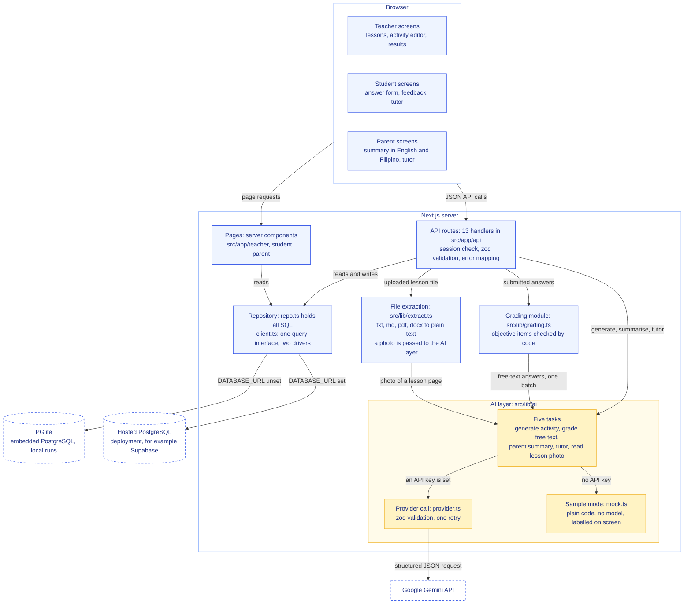
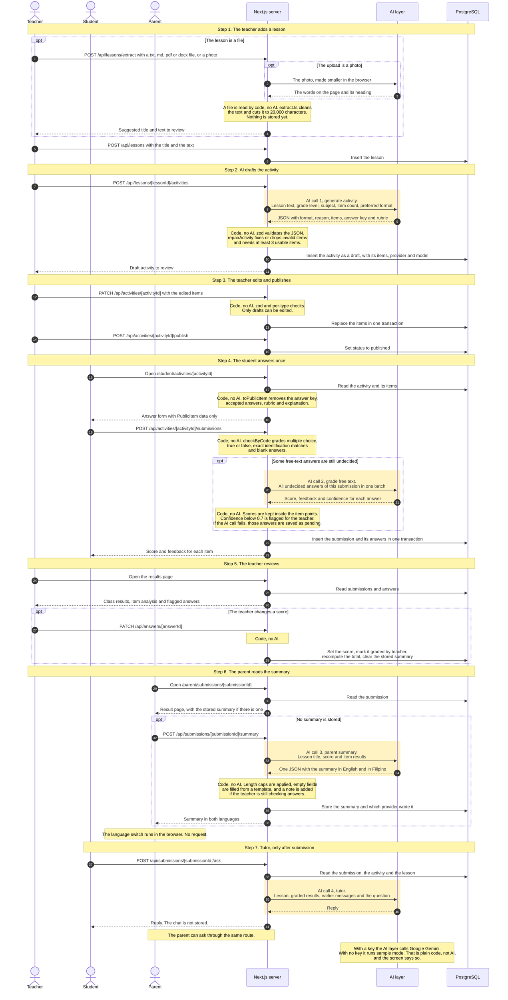
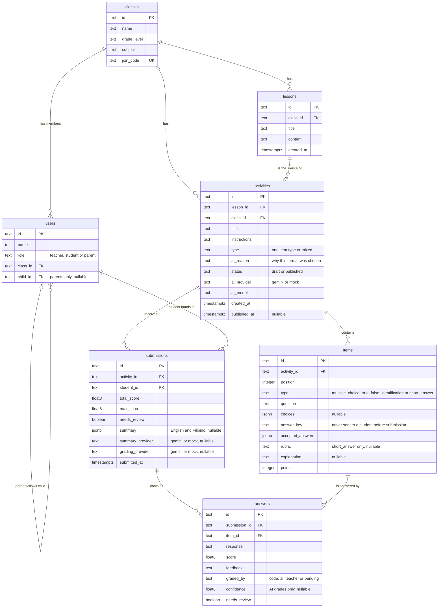

# AralLoop architecture

This document describes how the AralLoop prototype is built. Everything here is taken from the source code in `src/`.

A slide-ready overview in four parts (browser, server, AI service, database) is in [architecture.svg](./architecture.svg). The first diagram below shows the modules inside the server.

## What has and has not been verified

- Verified: typecheck, lint, the unit tests and the production build pass. The whole loop has been clicked through in a browser in sample mode, on the embedded database.
- Verified with live AI: one full loop was run with a live Google Gemini key and all four AI tasks of the loop answered. Reading a lesson from a photo was tried once with live Gemini, on a generated page of printed text; real phone photos and handwriting have not been tried. `npm run check:ai` makes one small real call with the configured key.
- Not yet verified: the hosted PostgreSQL path. The `pg` driver code is written, but only PGlite has run.
- Sample mode is not AI. With no API key the app runs plain code that builds stand-in results and labels them "Sample mode · not real AI" on screen.

## 1. System architecture

How to read it:

- **Browser.** Three sets of screens, one per role. Pages are rendered on the server. The browser only calls the API to change something or to ask for AI output.
- **Pages.** Server components in `src/app/teacher`, `src/app/student` and `src/app/parent` read data through the repository and decide what each role may see.
- **API routes.** 11 route files export 13 handlers. Each handler uses the helpers in `src/lib/http.ts`: `requireUser` checks the session cookie and the role, `parseBody` validates the body with a zod schema from `src/lib/contracts.ts`, and `route()` turns any thrown error into a JSON error with a message that is safe to show. An AI failure becomes a 503 with a plain explanation. Choosing a sample account and resetting the sample data need no account.
- **File extraction.** `src/lib/extract.ts` turns a `.txt`, `.md`, `.pdf` or `.docx` upload into plain text. It runs on the server only. A photo of a lesson page (`.jpg`, `.png`, `.webp`, `.heic`) is made smaller in the browser and read by the AI (`src/lib/ai/read-lesson-image.ts`), which only copies the words; the teacher checks the text before saving. A scanned PDF has no text, so the teacher is told to upload a photo or paste the lesson instead.
- **Grading module.** `src/lib/grading.ts` checks objective items with plain code and sends only the undecided free-text answers to the AI layer, in one batch.
- **AI layer.** `src/lib/ai` has five task files. Each one checks `getAiStatus()` first. With a key it calls `generateJson()` in `provider.ts`. With no key it calls `mock.ts`.
- **Provider selection.** `GEMINI_API_KEY` set: Google Gemini is used. No key: sample mode. `AI_PROVIDER=mock` forces sample mode. The provider layer is written so that a second provider can be added as a fallback; the prototype is set up and verified with Gemini only.
- **Repository.** `src/lib/db/repo.ts` holds all SQL. `src/lib/db/client.ts` picks the driver.
- **Session.** People sign up and log in with an email and a password. The password is stored as a scrypt hash. The `httpOnly` cookie holds a random token, and the `sessions` table holds its SHA-256 hash, so signing out ends the session on the server. The sample accounts have no password and can be opened from the first screen by anyone.

## 2. The full loop

Yellow bands are AI calls. Notes that start with "Code, no AI" are steps done by plain code.

### Where AI is called

| # | Task | Triggered by | Calls per event | What code does with the output |
|---|---|---|---|---|
| 1 | Generate activity (`generate-activity.ts`) | `POST /api/lessons/[lessonId]/activities` | One per draft | Validates with zod, repairs or drops items, recomputes the activity type, stores a draft |
| 2 | Grade free text (`grade.ts`) | `POST /api/activities/[activityId]/submissions` | At most one per submission. Zero if code settled every answer | Keeps scores in range, rounds to allowed steps, flags confidence below 0.7 |
| 3 | Parent summary (`parent-summary.ts`) | `POST /api/submissions/[submissionId]/summary` | One per submission, then stored. One more after a teacher override or a teacher-requested rewrite | Caps lengths, fills empty fields, adds the "teacher is still checking" note |
| 4 | Tutor (`tutor.ts`) | `POST /api/submissions/[submissionId]/ask` | One per question | Caps the reply at 1,200 characters. Nothing is stored |
| 5 | Read lesson photo (`read-lesson-image.ts`) | `POST /api/lessons/extract`, only when the upload is a photo | One per photo | Cleans the text, cuts it to 20,000 characters, refuses a result under 80 characters. Nothing is stored; the teacher checks the text in the form before saving |

### Where code does the work instead

- Reading uploaded text, PDF and Word files (`extract.ts`). Only a photo goes to AI.
- Checking multiple choice, true or false, exact identification matches and blank answers (`checkByCode` in `grading.ts`).
- Totals, the review flag and the class statistics on the results page.
- Teacher overrides.
- Removing the answer key before a student sees an activity (`toPublicItem`).
- Switching the parent summary between English and Filipino. Both texts arrive together.

## 3. Database tables

The schema is in `src/lib/db/schema.ts`. It is applied on first connection. Every statement is idempotent.

Constraints worth knowing:

- `submissions` is unique on `(activity_id, student_id)`. This is what enforces one attempt per student, even if two submits arrive at once.
- `answers` is unique on `(submission_id, item_id)`.
- Every foreign key deletes its children with the parent (`on delete cascade`), except `users.child_id`, which is set to null.
- `float8` above is PostgreSQL `double precision`. Short answers can earn half points.
- The provider columns record what really produced each result. A record made in sample mode stays labelled as sample mode after a key is added.
- The tutor chat has no table. The browser sends the last messages with each question.

## 4. Key design decisions

### One SQL codebase on two PostgreSQL drivers

`src/lib/db/client.ts` exposes one interface: `query` and `transaction`. With `DATABASE_URL` unset it opens PGlite, a real PostgreSQL that runs inside the Node process and stores its files in `.data/pglite`. With `DATABASE_URL` set it opens a `pg` connection pool to a hosted PostgreSQL such as Supabase. All SQL is in `repo.ts` and uses `$1` placeholders, so the same statements run on both.

Reason: the app starts with no database setup, which matters for a demo and for judges who run it themselves. Deployment needs a hosted database because the embedded one cannot be used on Vercel, and `client.ts` stops with a clear message if that is tried. Using PostgreSQL in both places avoids keeping two dialects in step.

Status: only the PGlite path has run so far.

### Structured output, validated with zod and repaired in code

Each AI task defines a zod schema. `provider.ts` converts it to JSON Schema and the adapter (`gemini.ts`) reduces it to what the API accepts, then asks for structured JSON with plain `fetch`. The reply is parsed and validated with the same zod schema. An invalid reply is retried once. A reply that says the service is busy or failed (HTTP 429 rate limit, 408 or 5xx) is retried once after 1.5 seconds. If it still fails, the route returns a clear error. Each try has 45 seconds and all tries share 55 seconds, so a route always answers before its 60-second limit.

After validation, each task repairs what it can:

- Activity: strips "A." labels from choices, matches the key to a choice, normalises true or false keys, keeps points between 1 and 5, removes repeated questions, drops items it cannot fix, and fails if fewer than 3 items are left.
- Grades: exactly one grade per answer, scores inside 0 to the item points, half steps for short answers, all or nothing for identification.
- Summary: at most 3 bullets per list, length caps, empty fields filled from a fixed template.
- Tutor: reply cut at 1,200 characters.

Reason: the screens never parse free text, and a teacher never opens a broken draft. A model can return a wrong shape at any time, so the code treats model output as untrusted input.

Lesson text, student answers and chat messages are also untrusted. They are passed to the model inside tagged blocks, tags inside them are removed, and every system prompt says that text in a block is data and not an instruction.

### Objective grading in code

`checkByCode` decides multiple choice and true or false items every time. It decides an identification item when the answer matches the key or an accepted answer after normalising case, accents, punctuation and leading articles. Blank answers are wrong without asking the AI. Only what is left goes to the model: identification answers with no exact match, and short answers.

Reason: code is exact, instant and free for answers that have one right value. The AI is used only where judging meaning is needed. A submission costs at most one AI call, and none if every answer was objective.

An AI failure never loses a submission. The free-text answers are saved with `graded_by = 'pending'` and wait for the teacher. AI grades with confidence below 0.7 are flagged for review, and the teacher can override any score.

### Parent summaries written on demand

The summary is not written at submission time. `POST /api/submissions/[submissionId]/summary` returns the stored summary if there is one and writes it otherwise. English and Filipino come back in one call and are stored together in `submissions.summary`. A teacher override clears the stored summary, so the next request writes a new one from the final scores. Only the class teacher can ask for a rewrite.

Reason: the summary always reflects the teacher's final scores, a reload never calls the AI again, and no call is spent on a submission nobody opens.

### The tutor only after submission

The tutor route is addressed by submission id, not by activity id. A submission exists only after the student has handed in their answers, so the route cannot be reached for an activity the student has not finished. Access is limited to the student who owns the submission, that student's parent and the class teacher.

Reason: the tutor prompt contains the answer key so that it can explain mistakes. Tying the route to a submission means it cannot be used to get answers before submitting. The system prompt also tells the tutor to stay on this lesson and activity, to refuse unrelated or unsuitable requests, that it cannot change a score, and to say it is an AI when asked.

### The answer key is stripped on the server with the `PublicItem` type

`Item` has the answer key, accepted answers, rubric and explanation. `PublicItem` is a `Pick` of `Item` with only `id`, `activityId`, `position`, `type`, `question`, `choices` and `points`. The student activity page is a server component. Before a submission exists it maps every item through `toPublicItem` and passes only `PublicItem[]` to the client answer form. The submission route uses the key on the server and returns scores and feedback, never the items. A draft activity is reported to students as not found.

Reason: the rule "the answer key must never reach a student's browser before they submit" is enforced where the data leaves the server, not hidden with CSS or client code. `toPublicItem` builds a new object field by field, so a field added to `Item` later is not sent by accident. `src/components/student/answer-key.test.ts` checks both the props sent to the client and the rendered HTML for the key, the accepted answers, the rubric and the explanation.

### Sample mode is separate from AI and is always labelled

With no API key, `mock.ts` builds each result with plain code: it picks sentences from the lesson, compares words for grading, and fills a fixed template for the summary. Its text says it is a sample made without AI. The `AiLabel` component shows "Sample mode · not real AI" for any record whose provider is `mock`. Sample grades always get a confidence of 0.4, so they are always sent to the teacher for review.

Reason: the app can be shown without a key or a connection to an AI service, and sample output is never passed off as AI. A failed AI call is never replaced with sample output. It returns a clear error, or for grading it leaves the answers pending for the teacher.
